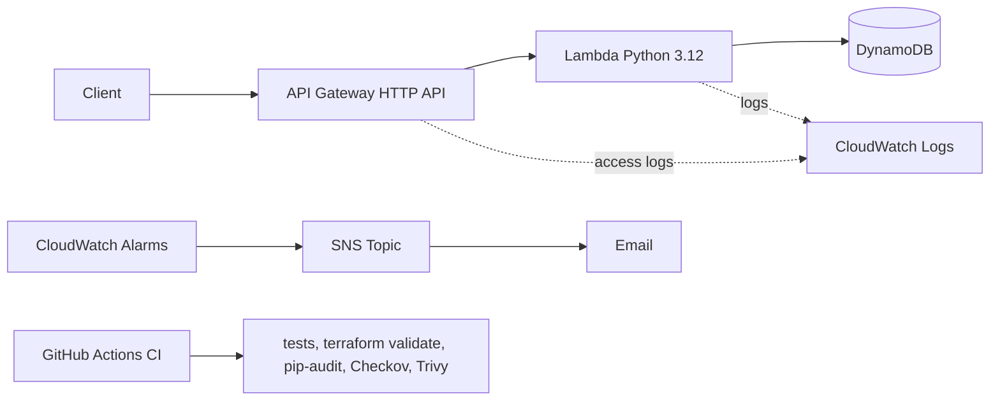

# Serverless DevSecOps Pipeline on AWS

A serverless items API (API Gateway, Lambda, DynamoDB) built entirely with Terraform,
with automated testing, security scanning, monitoring and an incident runbook.

## Architecture



## Tech stack

- **API:** Amazon API Gateway (HTTP API), AWS Lambda (Python 3.12), DynamoDB (on-demand)
- **Infrastructure as Code:** Terraform with reusable modules and remote state in S3 (native locking)
- **CI:** GitHub Actions (unit tests, `terraform fmt`/`validate`, pip-audit, Checkov, Trivy)
- **Monitoring:** CloudWatch alarms (Lambda errors, throttles, API 5xx), SNS email alerts
- **Operations:** Bash health-check and log-tailing scripts, incident runbook


## Security decisions

- **Least-privilege Lambda role:** only `PutItem`, `GetItem`, `Scan` on one table, and log writes to one log group.
- **API Gateway permission** is limited to this one API (`source_arn`).
- **Input validation** in the handler returns 400 on bad input.
- **Encryption and recovery:** DynamoDB server-side encryption and point-in-time recovery; state bucket is versioned, encrypted and blocks public access.
- **Cost and abuse protection:** API throttling (10 req/s, burst 20), 14-day log retention, small Lambda memory and timeout.
- **Pipeline gates:** pip-audit, Checkov (122 passed, 0 failed) and Trivy (no secrets or vulnerabilities found) run on every push.
- **Documented skips:** every skipped check has a written reason in `.checkov.yaml` and `.trivyignore` (for example customer-managed KMS keys, VPC for Lambda, code signing).

## How to deploy

Requirements: Terraform 1.10+, AWS CLI v2, an AWS account.

```bash
# 1. One-time: create the remote state bucket
cd terraform/bootstrap && terraform init && terraform apply

# 2. Deploy the app
cd ../envs
echo 'alert_email = "you@example.com"' > terraform.tfvars
terraform init && terraform apply

# 3. Smoke test
cd ../.. && ./scripts/health-check.sh
```

Update the bucket name in `terraform/envs/providers.tf` to the one printed by step 1.
Confirm the SNS subscription email to receive alerts.

## Estimated monthly cost

Roughly zero for low traffic: Lambda, API Gateway and DynamoDB are pay-per-use, alarms and SNS email are within the free tier. Log storage costs a few cents.
