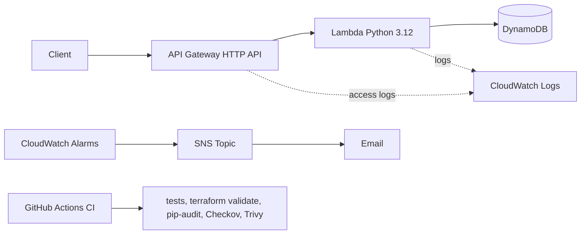

# Serverless DevSecOps Pipeline on AWS

A serverless items API (API Gateway, Lambda, DynamoDB) built entirely with Terraform,
with automated testing, security scanning, monitoring and an incident runbook.

## Architecture

## Tech stack

- **API:** Amazon API Gateway (HTTP API), AWS Lambda (Python 3.12), DynamoDB (on-demand)
- **Infrastructure as Code:** Terraform with reusable modules and remote state in S3 (native locking)
- **CI:** GitHub Actions (unit tests, `terraform fmt`/`validate`, pip-audit, Checkov, Trivy)
- **Monitoring:** CloudWatch alarms (Lambda errors, throttles, API 5xx), SNS email alerts
- **Operations:** Bash health-check and log-tailing scripts, incident runbook
